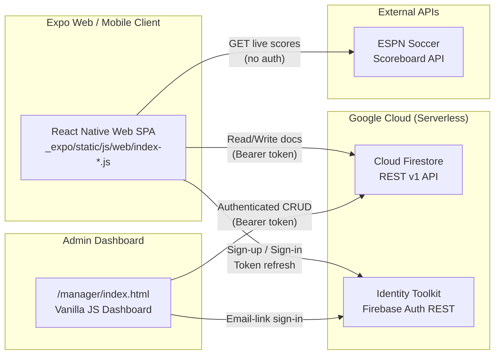
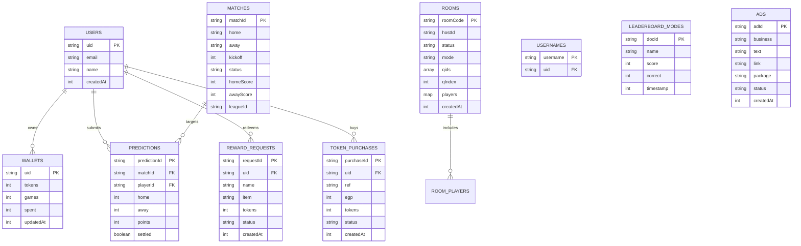
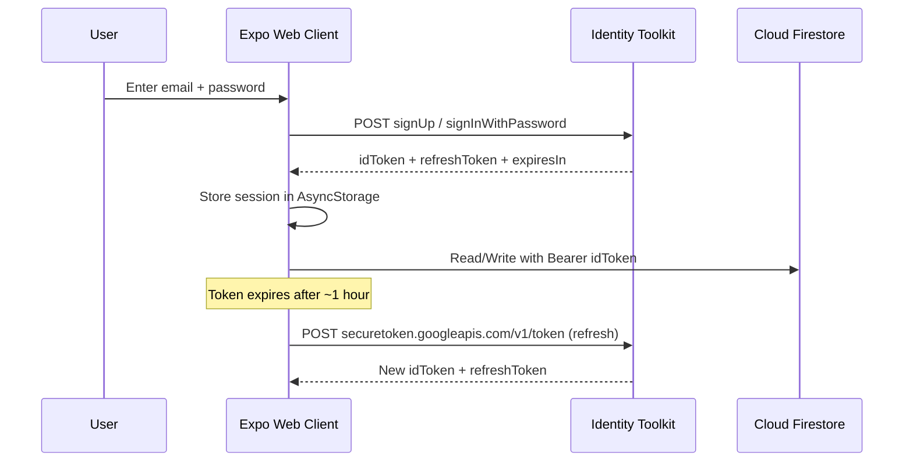

# ⚽ Kaweera (كويرة) · Architecture Document · v1.0.2

> **Permanent architecture reference** — this file is separate from `README.md` so deployment overwrites never erase it.

---

## 1. System Overview & Architecture Diagram

Kaweera is a **static single-page application (SPA)** exported from Expo/React Native Web. The client communicates directly with Google Cloud Firestore (REST v1) and the Google Identity Toolkit for authentication. Live match data is fetched client-side from the ESPN Soccer Scoreboard API. An admin dashboard (`/manager/`) provides back-office management, also as a static HTML page that authenticates via Firebase email-link sign-in.



### Data Flow Summary

| Flow | Protocol | Auth |
|:-----|:---------|:-----|
| Client → Firestore | HTTPS REST v1 | Firebase `idToken` (Bearer) |
| Client → Identity Toolkit | HTTPS REST | API Key |
| Client → ESPN Scoreboard | HTTPS GET | None (public) |
| Manager → Firestore | HTTPS REST v1 | Firebase `idToken` (Bearer) |
| Token refresh | `securetoken.googleapis.com` | `refreshToken` |

---

## 2. Tech Stack & Core Modules

| Layer | Technology | Notes |
|:------|:-----------|:------|
| **Frontend** | React Native + React Native Web | Universal component model |
| **Platform** | Expo SDK 51+ / Metro bundler | Static web export to `_expo/static/js/web/` |
| **Language** | JavaScript (ES2023+) / TypeScript | Minified production bundle (~1.5 MB) |
| **Database** | Cloud Firestore (project: `kora-w-bas`) | REST v1 via `firestore.googleapis.com` |
| **Auth** | Google Identity Toolkit (Firebase Auth) | Email/password + email-link sign-in |
| **Fonts** | `@expo-google-fonts/cairo`, `lalezar`, `bebas-neue` | Bundled as `.ttf` in `/assets/node_modules/` |
| **Live Data** | ESPN Soccer Scoreboard API | Client-side fetch, ~45 s cache |
| **Local Storage** | `AsyncStorage` (web: `localStorage` adapter) | Session tokens, preferences, offline drafts |
| **Admin** | Kaweera Manager (vanilla HTML5/JS) | Single-file dashboard at `/manager/index.html` |

### Firestore Collections Schema



Additional supporting collections:
- **`paymentProofs/`** — Base64 screenshot images tied to `tokenPurchases` by document ID.
- **`adContacts/`** — Advertiser contact info, tied to `ads` by document ID.
- **`adReports/`** — User-submitted ad abuse reports.
- **`predictionScores/`** — Aggregated prediction leaderboard.
- **`config/payments`** — Single doc: InstaPay address, weekly/monthly ad prices.
- **`leaderboard_easy`, `leaderboard_medium`, `leaderboard_hard`, `leaderboard_mixed`, `leaderboard_daily`** — Per-mode leaderboard collections.

### Authentication Flow



---

## 3. Core Game Mechanics & Economy Formulas

### Scoring Engine

| Component | Formula / Rule |
|:----------|:---------------|
| **Base Points** | Easy = 10, Medium = 20, Hard = 30 |
| **Speed Bonus** | $\text{Bonus} = \text{round}\!\left(0.5 \times \text{Base} \times \frac{\text{TimeLeft}}{\text{TimeLimit}}\right)$ |
| **Streak Multiplier** | +5 pts per consecutive correct answer (capped at +25 pts max) |
| **Flash Round** | 5 questions, 5 seconds each, flat 10 pts per correct answer |
| **Lives** | 3 per round; wrong answer or timeout = −1 life |

### Match Prediction Scoring

| Outcome | Points |
|:--------|:-------|
| **Exact scoreline** (e.g., predicted 2-1, result 2-1) | **5 pts** |
| **Correct match outcome** (Home/Draw/Away only) | **2 pts** |

### Token Economy

| Parameter | Value |
|:----------|:------|
| Earn per Easy game | 5 tokens |
| Earn per Medium game | 10 tokens |
| Earn per Hard game | 15 tokens |
| Earn per Mixed / Daily game | 10 tokens |
| **Conversion rate** | 200 tokens = 1 EGP |
| Purchase pack | 200 tokens for 10 EGP via InstaPay |

### Rewards Shop Catalog

| Reward | Token Cost | EGP Equivalent |
|:-------|:-----------|:---------------|
| 🎟️ Match Ticket | 20,000 | 100 EGP |
| 🪪 Fan Card | 44,000 | 220 EGP |
| ⚽ Football | 60,000 | 300 EGP |
| 👕 Fan Jersey | 100,000 | 500 EGP |
| 👟 Football Boots | 400,000 | 2,000 EGP |
| 🏆 Official Match Kit | 600,000 | 3,000 EGP |

---

## 4. Directory Structure & Responsibilities

```
Kaweera v1.0.2/                     ← Deployment root (= Hostinger public_html)
├── .htaccess                       ← Apache/LiteSpeed: HTTPS, SPA fallback, caching, security headers
├── .nojekyll                       ← Bypass Jekyll on GitHub Pages
├── index.html                      ← SPA entry point (meta tags, JS bundle loader)
├── favicon.ico                     ← App icon (14 KB)
├── metadata.json                   ← Expo Metro bundler manifest
├── README.md                       ← Short public README
├── ARCHITECTURE.md                 ← THIS FILE — permanent architecture reference
├── DEPLOYMENT.md                   ← Hostinger deployment checklist
│
├── _expo/
│   └── static/js/web/
│       └── index-<hash>.js         ← Production Metro bundle (~1.5 MB)
│                                      Contains: React, React Native Web, app screens,
│                                      1,077+ question bank, navigation, Firestore client,
│                                      auth module, scoring engine, token economy, i18n strings
│
├── assets/
│   ├── assets/                     ← Static images
│   │   ├── ball.<hash>.png         ← 3D football emblem (512×512)
│   │   ├── wordmark-ar.<hash>.png  ← Arabic logo "كويرة" (810×478)
│   │   ├── wordmark-dots.<hash>.png← Diacritic accent marks (148×90)
│   │   └── instapay-qr.<hash>.jpg  ← InstaPay QR code (761×629)
│   └── node_modules/
│       └── @expo-google-fonts/
│           ├── bebas-neue/         ← Bebas Neue 400 Regular (.ttf)
│           ├── cairo/              ← Cairo 200–900 weights (.ttf)
│           └── lalezar/            ← Lalezar 400 Regular (.ttf)
│
├── manager/
│   └── index.html                  ← Admin dashboard (single-file vanilla HTML/JS)
│                                      Tabs: Payments, Rewards, Players, Leaderboards, Ads, InstaPay config
│
└── MD/
    ├── ARCHITECTURE.md             ← Backup copy of this document
    └── README.md                   ← Backup copy of README
```

### Key Module Map (inside the JS bundle)

| Module Area | Responsibility |
|:------------|:---------------|
| **App Root** (module ~139) | Font loading, `LangContext`, `NavContext`, screen router |
| **Navigation** (`useNav`, `NavContext`) | In-memory stack navigation via React Context (no URL routing) |
| **Firestore Client** (`createDoc`, `getDoc`, `patchDoc`, `docsWhere`, `topDocs`) | REST v1 wrapper with Bearer auth |
| **Auth Module** (`restoreAccount`, `signUp`, `signIn`, `signOut`) | Identity Toolkit integration + AsyncStorage session |
| **Token Economy** (`earnTokens`, `requestTokenPurchase`, `requestReward`) | Wallet CRUD, token pack definition |
| **Ad Service** (`submitAd`, `getApprovedAds`, `reportAd`, `isSafeLink`) | Ad lifecycle + URL safety validation |
| **Live Scores** (ESPN fetch) | Scoreboard ingestion across 5 competition tiers |
| **Question Bank** (inline data) | 1,077+ questions across 12 categories, 3 difficulties, 3 languages |
| **i18n Strings** (`STRINGS[en/ar/fr]`) | Full UI translation dictionary |

---

## 5. Security & Scalability Roadmap

### Current Security Posture

| Area | Status | Notes |
|:-----|:-------|:------|
| API Key exposure | ⚠️ Public client key | `AIzaSy...` is restricted by Firestore Security Rules. Acceptable for client apps but should be domain-restricted in Google Cloud Console. |
| Firestore writes | ⚠️ Client-side | `wallets/`, `tokenPurchases/`, `rewardRequests/` are written from the client. **Firestore Security Rules must enforce**: only authenticated users writing their own docs, no direct `tokens` increment on `wallets/`. |
| Ad link validation | ✅ Client-side `isSafeLink` | Regex enforces `https://` scheme. Manager should also validate before approving. |
| XSS in Manager | ✅ Patched | `esc()` escapes `& < > " '`. Proof images validated to `https://` or `data:image/` only. |
| Question Bank | ⚠️ Client-bundled | All 1,077+ questions are in the JS bundle, extractable by any user. |
| Email/owner check | ✅ Client + Rules | Manager login restricted to `OWNER` email; Firestore rules should also enforce this. |

### Recommended Roadmap

1. **Decouple the Question Bank to a Private API**
   - Move questions to a server-side endpoint (e.g., Cloud Functions or a lightweight Node.js API on Hostinger VPS).
   - Serve questions on-demand per round (20 random questions per request), never exposing the full bank.

2. **Server-Side Token Verification**
   - Move `earnTokens` and `requestTokenPurchase` to Cloud Functions.
   - Validate game completion server-side before crediting tokens (prevent client-side manipulation).

3. **AI Assistant Logic (Future)**
   - If an AI-powered assistant is added, its prompts and logic should live server-side only.
   - Use Cloud Functions or a private API to proxy AI requests.

4. **Domain-Restrict the Firebase API Key**
   - In Google Cloud Console → Credentials, restrict the API key to your production domain(s).
   - Add HTTP referrer restrictions.

5. **Rate Limiting**
   - Implement rate limiting on Firestore writes via Security Rules (e.g., max 1 write per second per user on `wallets/`).
   - Consider Cloudflare or Hostinger's built-in WAF for DDoS protection.

6. **Content Security Policy (CSP)**
   - Add a CSP header in `.htaccess` once all external resource origins are catalogued:
     ```
     Content-Security-Policy: default-src 'self'; script-src 'self'; connect-src https://firestore.googleapis.com https://identitytoolkit.googleapis.com https://securetoken.googleapis.com https://site.api.espn.com; font-src 'self'; img-src 'self' data: https:; style-src 'self' 'unsafe-inline';
     ```

7. **Monitoring & Alerts**
   - Enable Firebase Usage Alerts and Firestore billing alerts.
   - Monitor the Manager dashboard's `setInterval` polling (currently 30 s) for excessive reads.
